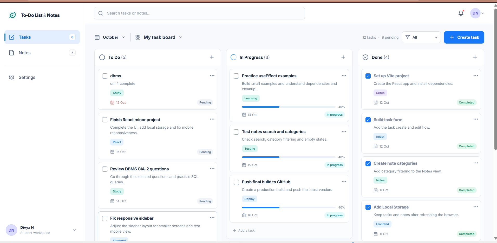
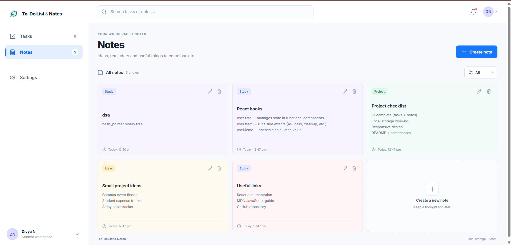
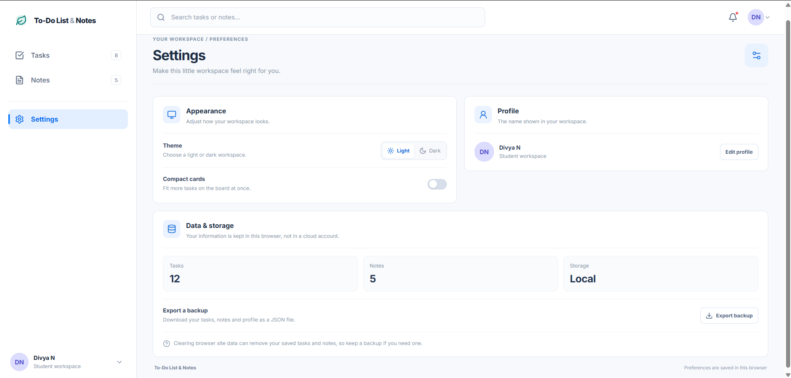

# To-Do List & Notes

A responsive productivity web application built with React that helps users organize daily tasks, manage notes, and keep track of their activities through a clean, interactive interface.

## Features

- **Task Management:** Organize and track tasks using a Kanban-style task board.
- **Notes Management:** Create and manage notes in one place.
- **Notifications:** View notifications within the application.
- **Profile:** Access your profile section.
- **Settings:** Manage application settings through a dedicated interface.
- **Data Persistence:** Store supported application data in browser Local Storage.
- **Responsive Interface:** Use the application across different screen sizes.

## Screenshots

### Tasks Board


### Notes Page


### Settings Page


## Tech Stack

- React.js
- JavaScript (ES6+)
- Vite
- CSS
- Browser Local Storage

## Getting Started

### Prerequisites

Install [Node.js](https://nodejs.org/) and npm before running the project.

### Installation

1. Clone the repository:

   ```bash
   git clone https://github.com/divya-code-tech/todo-list-notes.git
   ```

2. Navigate to the project directory:

   ```bash
   cd todo-list-notes
   ```

3. Install dependencies:

   ```bash
   npm install
   ```

4. Start the development server:

   ```bash
   npm run dev
   ```

5. Open the local URL displayed in your terminal.

## Production Build

To create an optimized production build, run:

```bash
npm run build
```

To preview the production build locally, run:

```bash
npm run preview
```

## Project Structure

todo-list-notes/
├── public/
├── screenshots/
│   ├── tasks.png
│   ├── notes.png
│   └── settings.png
├── src/
├── index.html
├── package.json
├── package-lock.json
├── vite.config.js
└── README.md

*Note: The exact folders and files may vary depending on the current project structure.*

## Future Improvements

- Add task deadlines and priority levels.
- Improve note organization with categories and search.
- Add dark mode and more personalization options.
- Explore cloud synchronization and user authentication.

## Author

**Divya N**

- GitHub: [divya-code-tech](https://github.com/divya-code-tech)

---

Built as a personal project to practice React development and create a useful productivity application.